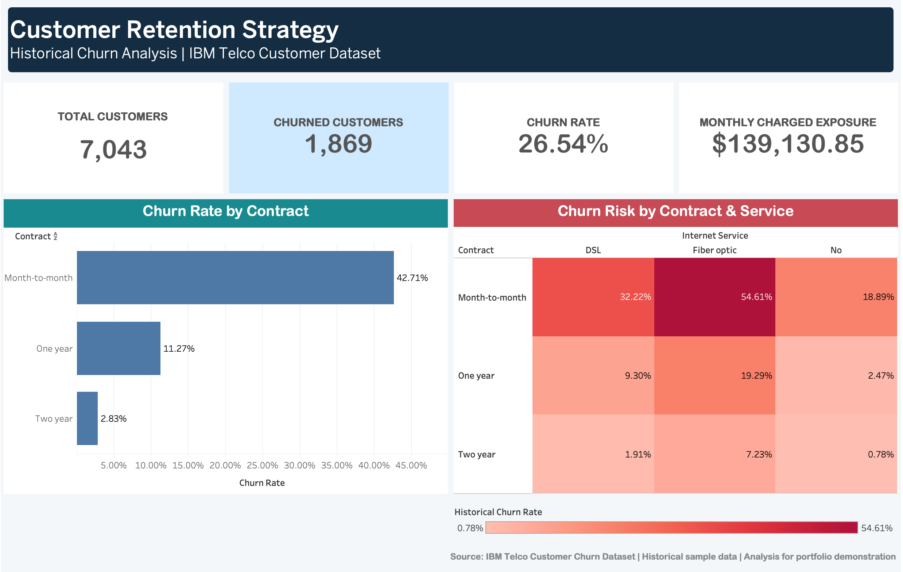

# Customer Retention Strategy | Telecom Analytics Case Study

**Business intelligence portfolio project** · Tableau · SQL (SQLite) · Python · Excel · interactive HTML

An independent retention-analytics case study using the **IBM Telco Customer Churn** sample. The goal is to identify where historical churn and associated monthly customer charges are concentrated, prioritize hypotheses for a retention pilot, and test the economics of a proposed intervention under clearly stated assumptions.

> **Data context:** IBM's fictional telecom customer sample is a cross-sectional benchmark, not company production data. `Churn = Yes` means the customer is labeled as having departed within the last month. This project does not claim to predict individual churn, identify causal drivers, or measure real campaign ROI.

## Tableau dashboard



The Tableau dashboard presents four customer-retention KPIs, historical churn by contract type, and a contract × internet-service heatmap. It uses the validated IBM Telco sample.

**Explore:** [View the dashboard screenshot](tableau/dashboard_final.png) · [Download the Tableau packaged workbook (.twbx)](tableau/Customer_Retention_Strategy.twbx) · [Read the Tableau build guide](tableau/TABLEAU_BUILD_GUIDE.md)

## At a glance

| Verified sample KPI | Value |
|---|---:|
| Customer records | 7,043 |
| Customers labeled churned | 1,869 |
| Historical churn rate | 26.54% |
| Monthly charges across all records | $456,116.60 |
| Monthly charges of churn-labeled records | $139,130.85 |
| Source `TotalCharges` blanks at zero tenure | 11 |

The last two charge figures are **descriptive sums**, not financial-statement revenue or demonstrated revenue loss. The data contains a historical label but no observed post-intervention results.

## Open the dashboards

**Explore the deliverables:**

- Open the [native Tableau packaged workbook](tableau/Customer_Retention_Strategy.twbx) in Tableau Desktop, or preview its [dashboard screenshot](tableau/dashboard_final.png).

- Open [`dashboards/retention_dashboard.html`](dashboards/retention_dashboard.html) in Chrome, Safari, or another modern browser. It has a built-in, verified cohort snapshot and works offline.
- Open [`dashboards/customer_retention_dashboard.xlsx`](dashboards/customer_retention_dashboard.xlsx) in Microsoft Excel. It contains four analytical sheets and a formula-driven scenario planner.
- If you want cross-filtering by individual customers in the browser, download the raw IBM CSV using the pipeline below and choose **Load full CSV** on the dashboard. The snapshot mode does not require the customer-level file.

**What you can customize:** Change the HTML dashboard accent color from the top-right color picker. Adjust the scenario coverage, assumed churn-prevention rate, cost per contact, incentive, horizon, and cohort. In Excel, edit blue scenario input cells and choose a cohort from the dropdown.

## Folder structure

```text
customer-retention-strategy/
├── dashboards/
│   ├── retention_dashboard.html      # Fully interactive, offline-capable view
│   └── customer_retention_dashboard.xlsx  # Excel dashboard + scenario model
├── data/
│   ├── raw/                           # Original dataset downloaded on demand
│   └── processed/
│       └── analysis_snapshot.json     # Source-verified aggregate snapshot
├── docs/
│   ├── BUSINESS_CASE.md
│   ├── KPI_DICTIONARY.md
│   ├── DATA_SOURCE.md
│   └── VALIDATION.md
├── sql/
│   ├── 01_schema.sql
│   ├── 02_views.sql
│   └── 03_quality_checks.sql
├── src/
│   └── pipeline.py
├── tableau/
│   ├── Customer_Retention_Strategy.twbx  # Packaged Tableau dashboard
│   ├── dashboard_final.png               # Screenshot for portfolio
│   ├── contract_summary.csv
│   ├── contract_internet_summary.csv
│   ├── internet_summary.csv
│   ├── payment_summary.csv
│   ├── priority_summary.csv
│   ├── tenure_summary.csv
│   └── TABLEAU_BUILD_GUIDE.md
└── tests/
```

## Reproduce the data with Python 3.10+

No Python packages are required. Run from the project root:

```bash
python3 -m src.pipeline
python3 -m unittest discover -s tests -v
```

The pipeline downloads the 21-column CSV from IBM's official GitHub archive and **verifies its SHA-256 checksum** before processing. It validates customer IDs, normalizes `TotalCharges`, creates segmentation features, rebuilds summary extracts, and writes a SQLite database at `data/processed/customer_retention.db`. The download is required only once.

To use a manually downloaded copy:

```bash
python3 -m src.pipeline --source /path/to/Telco-Customer-Churn.csv
```

To query the local SQLite file:

```bash
python3 - <<'PY'
import sqlite3
with sqlite3.connect('data/processed/customer_retention.db') as db:
    for row in db.execute('SELECT * FROM v_retention_priorities'):
        print(row)
PY
```

Note: If you run the pipeline against a different CSV, the exported results will change. The prebuilt Excel workbook represents the verified **original IBM snapshot**, not arbitrary alternate files.

## Analytical questions and findings

1. **Which contract types have the highest historical churn?** Month-to-month churn is 42.71% (1,655 of 3,875), compared with 11.27% for one-year and 2.83% for two-year contracts.
2. **Where is the most concentrated historical monthly-charge exposure?** Month-to-month fiber customers account for **1,162 of 1,869 churn labels** and **$100,482** in monthly charges of churn-labeled records.
3. **Which tenure cohort warrants deeper investigation?** Customers with tenure below one year show **999 churn labels among 2,069 customers**, a 48.28% observed churn rate.
4. **What is an initial retention hypothesis?** Pilot onboarding / service-quality outreach for flexible-contract fiber customers. Validate effectiveness and costs with a controlled test before rollout.

These are observational findings, not proof that contracts, services, or onboarding *cause* churn.

## Model logic and assumptions

In the scenario model, for a given historical cohort:

```text
Customers contacted = cohort customers × contact coverage
Modeled prevented churn events = cohort historical churned × coverage × prevention effectiveness
Gross monthly charge equivalent = historical churner monthly charges × coverage × effectiveness × months
Program spend = contacted customers × cost per contact + modeled prevented events × one-time incentive
Modeled net value = gross equivalent − program spend
```

The model is illustrative. It uses historical churn and monthly charges as a proxy, assumes uniform coverage and stable charges, and does not incorporate discounting, seasonality, acquisition cost, or causal response rates.

## How to present this project

**Business problem:** identify customer groups with high historical churn and quantify exposure proxies to focus a proposed retention experiment.

**Analytical contribution:** design reproducible SQL views and Python transformations; validate source data; develop interactive segment comparisons and a transparent scenario model; document limitations and pilot recommendations.

**Tableau deliverable:** Open [`tableau/Customer_Retention_Strategy.twbx`](tableau/Customer_Retention_Strategy.twbx) to explore the completed packaged dashboard. The [`tableau/TABLEAU_BUILD_GUIDE.md`](tableau/TABLEAU_BUILD_GUIDE.md) documents how to recreate its views from `data/processed/clean_customers.csv` or the provided summary extracts.

## Source and credits

The original data comes from **IBM / telco-customer-churn-on-icp4d**:

- Dataset: https://raw.githubusercontent.com/IBM/telco-customer-churn-on-icp4d/master/data/Telco-Customer-Churn.csv
- Original source repository: https://github.com/IBM/telco-customer-churn-on-icp4d
- IBM sample documentation: https://www.ibm.com/docs/en/cognos-analytics/12.0.x?topic=samples-telco-customer-churn
- Original code pattern license: Apache License 2.0, https://github.com/IBM/telco-customer-churn-on-icp4d/blob/master/LICENSE

No third-party dashboard design or code was copied into this project. The raw CSV is not packaged in the repository archive; the reproducible downloader fetches it from IBM and checks integrity. Attribution to the data publisher is preserved.
